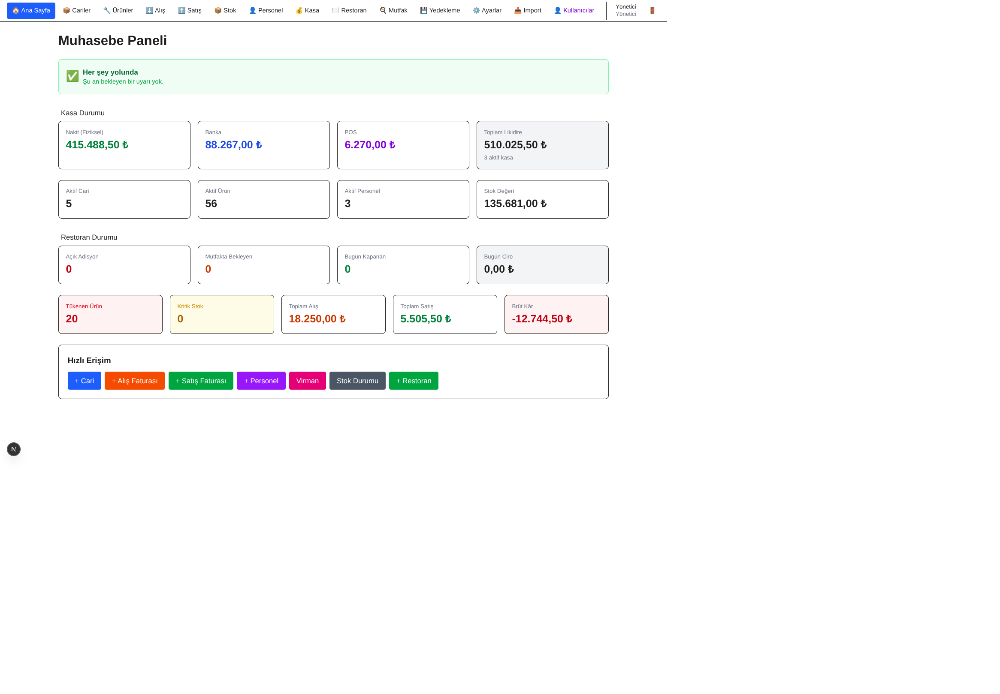
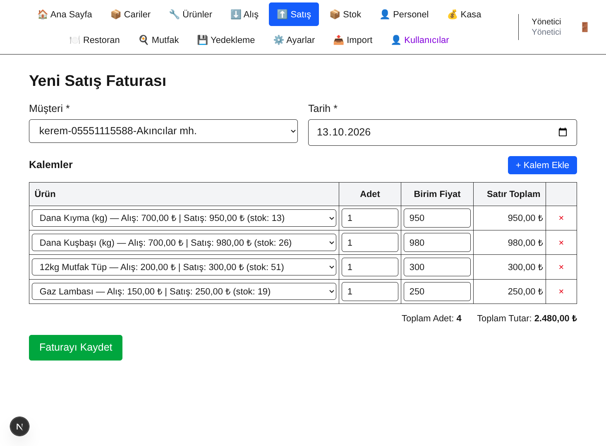
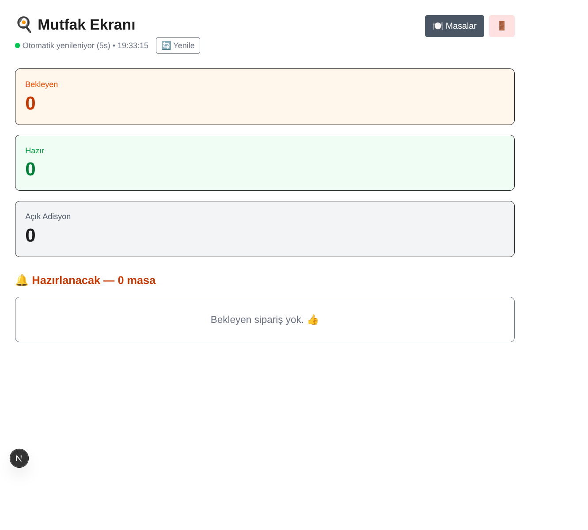
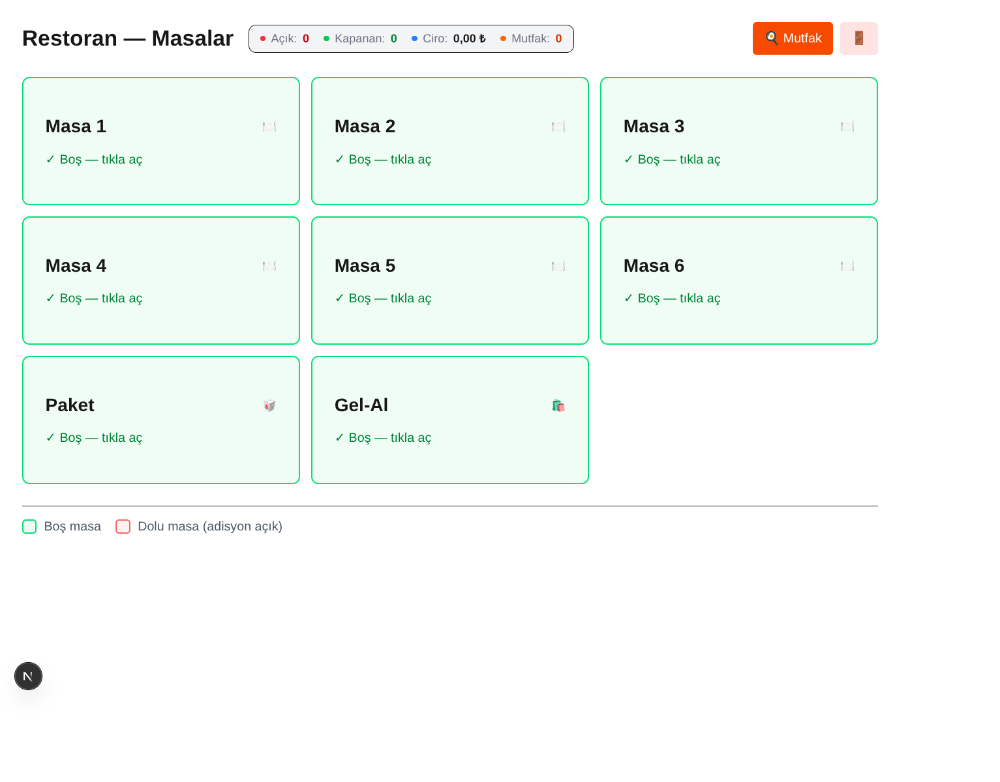

# 🧾 Muhasebe Sistemi

KOBİ'ler ve restoranlar için **tam kapsamlı** muhasebe + restoran yönetim sistemi.

Excel'de yıllardır kullandığım muhasebe sistemimi **modern web teknolojileriyle** yeniden yazdım. Faturalardan stok takibine, personel maaşlarından restoran masalarına kadar **tek sistemde** her şey.


---

## ✨ Özellikler

### 📊 Muhasebe
- **Cari Hesap** — Tedarikçi + müşteri birleşik yönetim
- **Alış Faturaları** — Karkas, hammadde girişi
- **Satış Faturaları** — Müşteri satışları
- **Ödeme / Tahsilat** — Kısmi ve tam ödeme takibi
- **Cari Ekstre** — Detaylı borç/alacak dökümü

### 📦 Stok ve Ürün
- **Ürün Yönetimi** — Hammadde + satış ürünü ayrımı
- **Stok Takibi** — Anlık stok, kritik seviye uyarısı
- **Manuel Stok Hareketi** — Faturasız giriş/çıkış
- **Fire Kaydı** — İptal edilen siparişler için

### 👤 Personel
- **Personel Kayıtları** — TC, SGK, ehliyet, eğitim
- **Maaş Ödemeleri** — Aylık, avans, prim
- **Dönem Bazlı Bakiye** — Kalan maaş hesabı

### 💰 Kasa
- **Çoklu Kasa** — Nakit, banka, POS
- **Virman** — Kasalar arası transfer
- **Bakiye Takibi** — Anlık nakit durumu

### 🍽️ Restoran (Yeni!)
- **Masa Yönetimi** — 5-10 masa, paket, gel-al
- **Sipariş Ekranı** — Tablet uyumlu, adet +/-
- **Mutfak Ekranı** — Otomatik yenilenen canlı görünüm
- **Mutfak Akışı** — Gönder → Hazır → Servis
- **Adisyon Yazdırma** — A4 hesap fişi + 80mm termal fiş
- **Masa İptal** — Fire kaydı ile

### 📊 Raporlar
- **Dashboard** — Anlık özet + canlı uyarılar
- **Kâr/Zarar** — Aylık ciro, maliyet, marj
- **Restoran Raporu** — Günlük ciro, en çok satanlar
- **Bildirim Sistemi** — Kritik stok, ödenmemiş fatura, uzun açık masa

### 🔧 Diğer
- **Excel İçe/Dışa Aktarma** — Ürün, cari, fatura, stok
- **Otomatik Yedekleme** — Her gece 03:00'te SQL dump
- **Şirket Ayarları** — Fişlere ve faturalara yansır
- **Kullanıcı Yönetimi** — Admin / Personel rolleri
- **PDF Çıktı** — Fatura, hesap fişi, termal fiş
- **Auth** — JWT ile güvenli giriş

---

## 🛠️ Teknolojiler

| Katman | Teknoloji |
|--------|-----------|
| **Frontend** | Next.js 16 (App Router), React 19, Tailwind CSS 4 |
| **Backend** | Next.js Server Actions, Node.js |
| **Veritabanı** | MariaDB 11.4 (mysql2 değil, native `mariadb` sürücüsü) |
| **Auth** | JWT (`jose`), bcrypt şifre hash |
| **Excel** | `xlsx` (SheetJS) |
| **Zamanlayıcı** | `node-cron` yerine saf `setTimeout` |

---

## 📁 Proje Yapısı

```
muhasebe/
├── app/                    # Next.js sayfalar (App Router)
│   ├── cariler/            # Cari yönetimi
│   ├── alis-faturalar/     # Alış faturaları
│   ├── satis-faturalar/    # Satış faturaları
│   ├── urunler/            # Ürün yönetimi
│   ├── stok/               # Stok takibi
│   ├── personel/           # Personel + maaş
│   ├── kasa/               # Kasa + virman
│   ├── restoran/           # Masa + sipariş
│   ├── mutfak/             # Mutfak ekranı
│   ├── raporlar/           # Kâr/zarar
│   ├── ayarlar/            # Şirket bilgileri
│   ├── kullanicilar/       # Kullanıcı yönetimi
│   ├── profil/             # Şifre değiştirme
│   ├── import/             # Excel import
│   ├── giris/              # Login
│   └── yedekleme/          # Yedek yönetimi
├── actions/                # Server Actions
├── components/             # React bileşenleri
├── models/                 # Veritabanı katmanı
├── lib/                    # Yardımcı fonksiyonlar
├── database/
│   ├── migrations/         # SQL migration dosyaları
│   └── backups/            # Yedekler (gitignore)
├── scripts/                # Yardımcı scriptler
├── proxy.js                # Auth middleware (Next.js 16)
├── instrumentation.js      # Zamanlayıcı (otomatik yedek)
└── package.json
```

---

## 🚀 Kurulum

### Gereksinimler

- **Node.js** 20+
- **MariaDB** 11.4+
- **Yarn** (veya npm)

### 1. Repoyu Klonla

```bash
git clone https://github.com/kadrigerdan/muhasebe.git
cd muhasebe
```

### 2. Paketleri Kur

```bash
yarn install
```

### 3. Veritabanı Oluştur

```bash
mysql -u root -p
```

```sql
CREATE DATABASE muhasebe CHARACTER SET utf8mb4 COLLATE utf8mb4_unicode_ci;
```

Sonra `database/migrations/` klasöründeki SQL dosyalarını **sırayla** çalıştır.

### 4. Ortam Değişkenleri

`.env.local` dosyası oluştur:

```env
DB_HOST=127.0.0.1
DB_PORT=3306
DB_USER=kadri
DB_PASSWORD=sifren
DB_DATABASE=muhasebe
JWT_SECRET=rastgele_32_byte_hex
```

**JWT_SECRET üret:**

```bash
node -e "console.log(require('crypto').randomBytes(32).toString('hex'))"
```

### 5. Admin Kullanıcı Oluştur

```bash
node scripts/seed-admin.js
```

**Varsayılan:** `admin` / `admin123` (girişten sonra değiştir!)

### 6. Başlat

```bash
yarn dev
```

Aç: **http://localhost:3000**

---

## 📸 Ekran Görüntüleri

### Dashboard


### Satış Faturası


### Mutfak Ekranı


### Restoran — Masalar



## 💡 Kullanım Senaryoları

### Restoran / Kebapçı
- Masaları aç, sipariş al
- Mutfağa gönder, hazır işaretle
- Adisyon kapat, kasaya düş
- Günlük ciro raporu al

### Kasap / Market
- Alış faturası gir
- Stok takip et
- Faturasız girişleri manuel ekle
- Kritik stokta otomatik uyarı al

### KOBİ Muhasebesi
- Cari hesap yönet
- Alış/satış faturaları kes
- Tahsilat/ödeme takip et
- Kâr/zarar raporu al
- Personel maaşlarını yönet

---

## 🔒 Güvenlik

- **JWT** ile oturum yönetimi
- **bcrypt** ile şifre hash
- **httpOnly** cookie
- **Proxy middleware** ile sayfa koruması
- **Rol bazlı yetkilendirme** (admin/personel)
- `.env.local` Git'e **girmez**

---

## 📝 Notlar

- **Next.js 16** ile geliştirildi (`params` Promise, `proxy` middleware)
- **MariaDB native** sürücüsü kullanıldı (mysql2 değil)
- **Server Actions** ile API Route kullanılmadı
- **Kütüphanesiz zamanlayıcı** (node-cron yerine `setTimeout`)
- **Tablet ve telefon** uyumlu (dokunmatik)
- **80mm termal yazıcı** desteği

---

## 🎯 Yol Haritası

- [x] Muhasebe modülü (cari, fatura, kasa)
- [x] Stok takibi
- [x] Personel yönetimi
- [x] Restoran + Mutfak ekranı
- [x] Excel içe/dışa aktarma
- [x] Otomatik yedekleme
- [x] Auth + rol yönetimi
- [ ] Mobil uygulama (React Native)
- [ ] SMS/e-posta bildirimi
- [ ] Çok şubeli destek
- [ ] Yazıcı otomasyonu (ESC/POS)

---

## 👨‍💻 Geliştirici

**Kadri Gerdan**

- GitHub: [@kadrigerdan](https://github.com/kadrigerdan)
- Proje: [muhasebe](https://github.com/kadrigerdan/muhasebe)

---

## 📄 Lisans

Bu proje **kişisel kullanım** için geliştirilmiştir. Ticari kullanım için iletişime geçin.

---

## 🙏 Teşekkürler

- **Next.js** ekibine — harika framework için
- **MariaDB** topluluğuna
- Ve **6 ay boyunca** bu projeyi geliştirirken destek olan herkese

---

⭐ Bu proje işinize yaradıysa **yıldız** vermeyi unutmayın!
